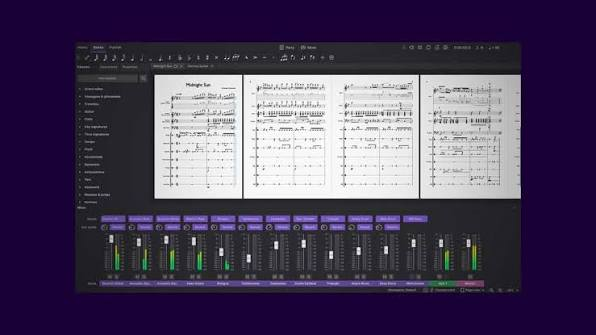
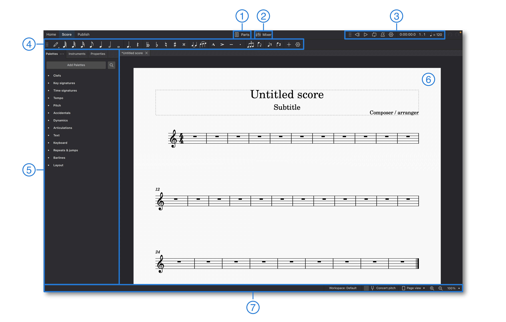

# MuseScore Studio for Scores Ready to Rehearse

A rehearsal needs more than correct pitches: each player needs a readable part, and the group needs a shared understanding of rhythm, dynamics, and repeats.
MuseScore Studio brings notation, linked parts, playback, and export into one desktop workflow for Windows, macOS, and Linux.

## Read the music from the player's chair

### Give each instrument a usable part

Open the Parts dialog and select the instrumental part you want to review.
Use the Layout panel to choose which instruments, staves, or voices appear in that part.
A shared staff in the full score does not require every player to receive the same printed view.

Check the first entrance after a long rest, the clef and key signature at a new system, and the space around rehearsal directions.
Review page turns while imagining the player holding the instrument.



### Separate musical edits from page decisions

Pitch and duration changes are shared between the score and its linked parts.
Part-specific styles and supported property overrides let you adjust presentation without duplicating the composition.
Consult the [official parts guide](https://handbook.musescore.org/en_gb/basics/parts) when deciding which properties should stay synchronized.

For readers studying the internal representation, [pitch.md](docs/old_docs/pitch.md) distinguishes absolute pitch from written spelling.
The related [tpc.md](docs/old_docs/tpc.md) explains enharmonic representation, while [ticklength.md](docs/old_docs/ticklength.md) describes duration relative to a quarter-note division.

Finish the notation pass before tightening individual systems.
Late changes to rhythms or instrumentation can alter the spacing of several pages.

[](https://musescore-studio.github.io/musescore-studio/)

## Listen for decisions the page cannot confirm

Playback helps reveal a missing accidental, an incorrect octave, or a repeat that does not unfold as intended.
It also exposes the difference between a written articulation and the sound assigned to an instrument.

1. Listen to a short passage with the relevant instrument isolated.
2. Check its dynamics and articulations against the notation.
3. Restore the ensemble and listen for balance.
4. Test repeats, endings, and tempo changes over the complete form.
5. Save the score after confirming the intended sound assignments.



MuseSounds provide sampled playback through separately installed sound libraries.
Available sounds can be assigned through Playback Setup and the Mixer; instruments without a matching MuseSound can use MS Basic.
See the [MuseSounds handbook page](https://handbook.musescore.org/sound-and-playback/musesounds) for the playback workflow.

The supplied [DownloadSoundFont.cmake](buildscripts/cmake/DownloadSoundFont.cmake) manages the build-time MS Basic SoundFont resource.
It does not describe the installation of the separate MuseSounds libraries.
Keep the playback profile and required sound resources with your rehearsal notes when reproducing an audio render.

## Send the right musical information to each recipient

Keep the native score as the editable master.
Select an additional output according to what the recipient needs to change or hear.

| Output | Editable score structure | Fixed page appearance | Rendered sound | Typical recipient |
| --- | --- | --- | --- | --- |
| MSCZ | Native editing | Layout can be revised | Played by the application | Another MuseScore Studio user |
| MusicXML | Exchangeable notation | May reflow on import | Played by the receiving tool | An editor using another notation program |
| MIDI | Performance events | No printed layout | Needs an instrument or synthesizer | A sequencing workflow |
| PDF | No native score editing | Yes | No | A player reading or printing parts |
| WAV or MP3 | No notation structure | No | Yes | A listener reviewing a performance |

Importing a PDF as editable notation is a different task from exporting a finished score to PDF.
When exchanging MusicXML, reopen the result and review tuplets, lyrics, articulations, and page layout.

With the application available as `mscore` on your command path, export an existing score in two forms:

```bash
mscore -o "Rehearsal.pdf" "Rehearsal.mscz"
mscore -o "Rehearsal.musicxml" "Rehearsal.mscz"
```

Use the executable name or full path provided by your installation.
The output extension selects the conversion format.
The [command-line handbook](https://handbook.musescore.org/appendix/command-line-usage) and supplied [mscore.1.in](buildscripts/packaging/Linux%2BBSD/mscore.1.in) document the conversion options.

## Repeat exports after a revision

A conversion job keeps a set of outputs tied to the same input score.
For a project named `Rehearsal.mscz`, the following original JSON recipe requests a PDF and MusicXML file:

```json
[
  {
    "in": "Rehearsal.mscz",
    "out": ["Rehearsal.pdf", "Rehearsal.musicxml"]
  }
]
```

Save that content as `rehearsal-job.json` beside the score, then invoke the native job option:

```bash
mscore -j rehearsal-job.json
```

Review the generated files before distributing them, particularly after changing instruments or pagination.
Use distinct revision names when players may already have an earlier copy.

The image-generation workflow in [generate_pngs.sh](buildscripts/ci/vtests/generate_pngs.sh) shows how the project produces visual comparison material.
The selected scenarios in [test_cases.txt](buildscripts/ci/testflow/test_cases.txt) cover note input, instruments, engraving text, and export.
They provide useful context for checking a notation workflow after an application update.

## Evaluate automation against the installed version

For musescore studio music notation tasks, extensions can be useful when a repeated operation deserves its own command or interface.
Choose an extension that explicitly supports the application version you use.

The supplied extension overview [Home.md](docs/apidocs_static/Home.md) introduces forms, macros, and composite extensions.
Its example workflow is in [1_getting_started.md](docs/apidocs_static/tutorials/1_getting_started.md).
The extension identifier and action declarations are explained in [2_manifest.md](docs/apidocs_static/tutorials/2_manifest.md).
Interface and script concepts are developed separately in [3_form.md](docs/apidocs_static/tutorials/3_form.md) and [4_macros.md](docs/apidocs_static/tutorials/4_macros.md).

For historical API context, [plugins.md](docs/old_docs/plugins.md) describes QML plugins.
The migration notes in [plugins2to3.md](docs/old_docs/plugins2to3.md) concern the transition between versions 2 and 3.
The translation discussion in [i18n.md](docs/old_docs/i18n.md) explains how plugin text can use translation functions.

Documentation generation is described in [README.md](docs/README.md), and [index.html](docs/index.html) is the API documentation entry page.
Use these references to identify the relevant API generation before adapting an example.

## Keep the working environment identifiable

Record the exact application release when handing off an editable score.
A search for musescore studio 4 can lead to release documentation that differs from development materials in a source snapshot.

Desktop file associations are represented by [org.musescore.MuseScore.desktop.in](buildscripts/packaging/Linux%2BBSD/org.musescore.MuseScore.desktop.in).
The macOS document declarations appear in [Info.plist.in](buildscripts/packaging/macOS/Info.plist.in).
The Windows portable launcher settings are in [MuseScorePortable.ini](buildscripts/packaging/Windows/PortableApps/App/AppInfo/Launcher/MuseScorePortable.ini).

For source-level investigation, [CMakeLists.txt](CMakeLists.txt) and [CMakePresets.json](CMakePresets.json) describe build configuration.
The supplied [LICENSE.txt](LICENSE.txt) records the source license, and [AI_POLICY.md](AI_POLICY.md) explains expectations for AI-assisted contributions to the upstream project.

## Related Search Terms

musescore studio, musescore studio, muse score studio, musescore studio 4, musescore studio music notation, music-notation, sheet-music, musicxml, midi, composition, engraving, playback, qt, cpp, musescore
